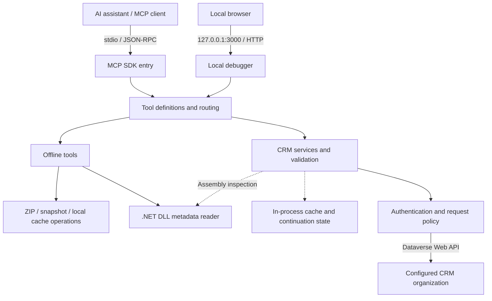
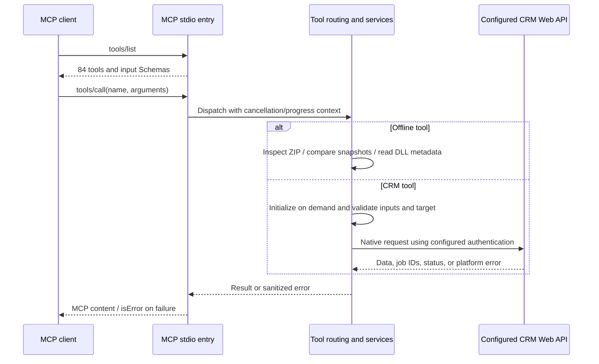
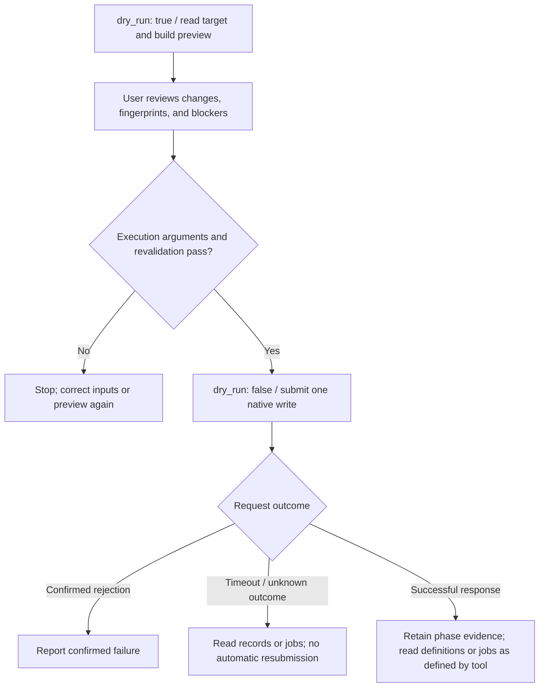
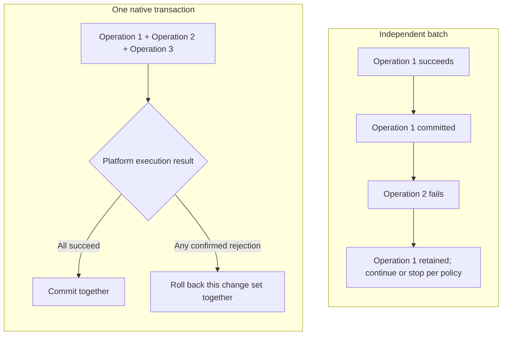
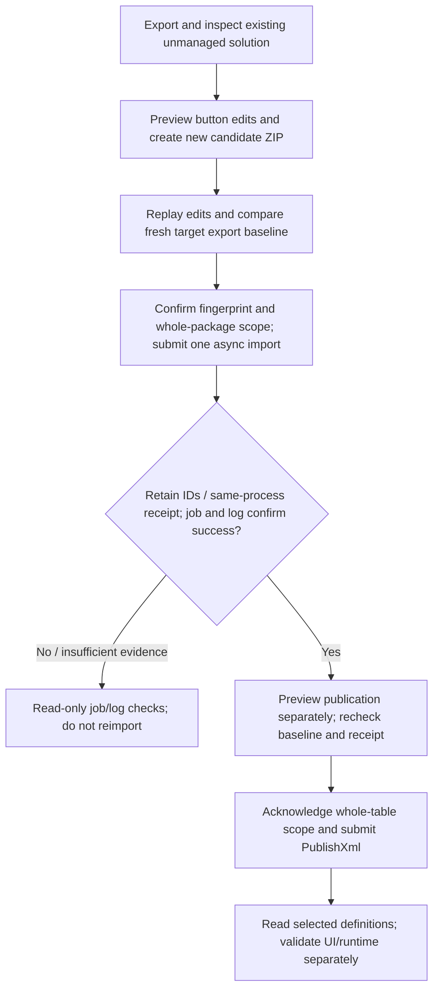

# Dynamics 365 MCP Server

[简体中文](README.md) | **English**

Connect AI assistants to Microsoft Dataverse / Dynamics 365 Customer Engagement through the Model Context Protocol (MCP).

Built with **TypeScript and the Dataverse Web API**, this server provides **84 tools** for record queries and mutations, metadata, Web Resources, plugin registration, data modeling, diagnostics and auditing, solutions, and classic Ribbon buttons. It connects to MCP clients over **stdio** and includes a local Web debugger.

**Current status:** local builds and 910 regression tests pass. 65/84 tools called; 20 specified write/readback paths passed and 2 publication requests were accepted (UI effects unverified). 19 tools remain uncalled. All objects created for this test were cleaned up; no pre-existing business object was modified. Full acceptance remains incomplete due to platform and capability limits; see the [per-tool coverage matrix](docs/CRM_TOOL_COVERAGE.md). Capabilities depend on the CRM version, customization support and identity permissions. Finance & Operations and Business Central are outside this scope.

[Feature checklist](#feature-checklist) · [Architecture and request flow](#architecture-and-request-flow) · [Quick start](#quick-start) · [Authentication](#authentication) · [Examples](#examples) · [Writes and deployment](#writes-publication-and-result-interpretation) · [Tool catalog](#tool-catalog) · [Testing and validation](#testing-and-validation)

## Feature checklist

The following capabilities are implemented in code and grouped by usage scenario. Implementation and passing local tests do not establish acceptance in a real CRM environment.

| Area | Tools | Capabilities |
| --- | ---: | --- |
| Environment and metadata | 8 | User and organization context, environment capabilities, tables, fields, choices, navigation relationships, and cache clearing |
| Queries and paging | 3 | OData, FetchXML, state filtering, paging, and query continuation |
| Records and transactions | 9 | CRUD, alternate-key upsert, associations, batches, and native transactions |
| Web Resources | 4 | Search, create, update, and independently publish resources such as scripts |
| Plugin registration | 11 | Assembly inspection and compatible updates, step registration and updates, and Pre/Post Images |
| Diagnostics, security, and audit | 9 | Plugin traces, failed jobs, principals and roles, effective access, and audit evidence |
| Data model and UI definitions | 20 | Tables, columns, relationships, alternate keys, choices, form/view structure, and publication |
| Actions and Functions | 2 | Discover native operation signatures from current CSDL, validate parameters, and invoke operations |
| Solutions | 12 | Components and dependencies, ZIP inspection, export and restricted import, job status, snapshots, and verification |
| Classic Ribbon | 6 | Read definitions, edit local candidate packages, perform controlled import, publish separately, and read definitions back |

Discover tools through MCP `tools/list` and invoke them through `tools/call`. **84 is the number of tools; 910 is the number of local test cases. These are different measures.** Live acceptance is tracked per tool. Preview, local-fixture, empty-result, and partial-read checks are not full functional acceptance; see the [84-tool matrix](docs/CRM_TOOL_COVERAGE.md). See the [tool reference](docs/TOOL_REFERENCE.md) for parameters and limitations.

### Queries, records, and operational evidence

| Feature | What you can do | Main boundary |
| --- | --- | --- |
| Environment inspection | Read current user/organization, server version, and visible capabilities | Metadata presence does not establish write permissions |
| Metadata queries | Read tables, fields, requirement levels, primary keys, choice labels, and navigation relationships | Limited to metadata visible to the connecting identity |
| OData / FetchXML queries | Filter, select, sort, apply state rules, retrieve formatted values, page, and resume results | Row/page limits apply; continuation state lives in the current process |
| Record maintenance | Read by ID, create, update, delete, and upsert through an active alternate key | Preflight and applicable concurrency rules apply; writes are not automatically retried |
| Record associations | Set/clear Lookups and add/remove collection relationships | Disassociation does not delete related records; collection changes require explicit acceptance of concurrency limits |
| Batches and transactions | Run independent operations in chunks or submit one native transactional change set | Independent batches do not roll back earlier operations; preflight reads occur outside the transaction |
| Plugin failure diagnostics | Read diagnostic settings, traces, and failed system jobs; link step evidence | Read-only analysis, without automatic repair or treating correlation as a proven cause |
| Security and audit | Inspect users/teams/roles, effective record access, and native audit details | No privilege elevation or role changes; old/new audit values are withheld by default |

### Development and customization

| Feature | What you can do | Main boundary |
| --- | --- | --- |
| Web Resources | Search by name, create/update content, and publish separately | Save and publication phases are reported separately; content reads are opt-in |
| Plugin assemblies | Query registration metadata, inspect local DLLs, and compatibly update existing assemblies | Inspected DLLs are not executed; new assembly registration is not provided |
| Plugin steps | Discover messages/types/filters, and query, register, or update steps | Registration uses existing plugin types; secure configuration reads are off by default |
| Plugin images | Query, register, update, and delete Pre/Post Images | Validates step applicability and field lists, with preview and concurrency checks |
| Tables and columns | Read definitions, create tables/supported column types, and maintain labels and column settings | Native metadata operations and solution/publisher checks apply; not every column type is supported |
| Relationships | Read/create 1:N, Lookup, and N:N relationships; maintain supported menus and cascade settings | Subject to target definitions, customizability, and preview fingerprints |
| Alternate keys | Read/create keys and resubmit indexing for Failed keys | Submission does not establish that the index is ready |
| Choices | Read local/global choices, create global Picklists, insert/update option labels, and publish separately | No arbitrary option deletion/renumbering; Boolean retains its 0/1 semantics |
| Forms and views | Read saved/unpublished definitions and make supported field, library, event, column, and ordering edits | Structural XML editing, without a visual designer or arbitrary layout rewriting |
| Actions and Functions | Discover current CSDL operations, bindings, overloads, and parameter types before invocation | Does not create or modify Custom API definitions; results follow native responses |

### Solutions and classic Ribbon

| Feature | What you can do | Main boundary |
| --- | --- | --- |
| Solutions and components | List solutions/members, inspect dependencies, and add existing components to unmanaged solutions | Does not create missing components or bypass platform dependency checks |
| Local ZIP inspection | Read manifests, file information, and hashes; reject unsupported or damaged packages | No CRM required; does not extract and execute package contents |
| Solution export | Export an ordinary unmanaged source as a managed or unmanaged ZIP | Writes a new local file without overwriting an existing file |
| First solution import | Preview/submit a first ordinary unmanaged async import and read jobs/logs by ID | No general existing-solution update or managed/patch/upgrade import; no automatic publication |
| Snapshots and verification | Capture visible membership and selected properties, compare offline, and check a target environment | Not a complete environment backup or proof of equivalent runtime behavior |
| Ribbon definition reads | Read effective buttons, command/rule references, insertion locations, and packaged RibbonDiffXml | Classic Ribbon scope, without complete modern command designer coverage |
| Local Ribbon editing | Add standalone custom JS buttons, update labels/order, hide/restore visibility, and create a candidate ZIP | Preserves other package contents; does not automatically import, publish, or execute JavaScript |
| Controlled Ribbon deployment | Import a candidate into an existing ordinary unmanaged solution, publish the table separately, and read selected definitions back | Explicit whole-package/table acknowledgments and a same-process receipt; UI acceptance remains separate |

## Architecture and request flow

### Overall architecture

The MCP stdio entry and local HTTP debugger share tool definitions and routing. Offline tools go directly to local handlers. CRM tools initialize services on demand and access the configured organization through a shared Web API client.



Configuration, caches, continuation state, and Ribbon import receipts belong to the server process; they are not a persistent workflow across processes. The .NET reader is used only by the relevant assembly inspection/update paths; other CRM tools do not depend on it.

### How a tool call completes

This diagram shows discovery and successful call paths. Configuration, input, or platform validation failures return early rather than continuing past the failed check.



## Quick start

### 1. Prerequisites

| Component | Requirement |
| --- | --- |
| Node.js | package.json declares `>=18`; this test pass used **24.18.0 and 24.22.1**. The Node 18 minimum has not been runtime-tested |
| npm | Required for source installation, builds, and tests; package-lock.json is included |
| .NET 10 Runtime | Required for local DLL inspection, assembly updates, and the full test suite. Other tools and assembly metadata queries do not require .NET |
| .NET 10 SDK | Required to rebuild the assembly reader, run `build:release`, or run `npm pack` |
| CRM connection | Required for CRM tools. Tool discovery, cache clearing, and some offline tools work without a connection |

DLL inspection uses a fixed .NET metadata reader and does not execute the inspected plugin DLL. The reader's .NET 10 requirement is separate from the target CRM plugin's framework requirements. If dotnet is not on PATH, set `D365_DOTNET_PATH` to its absolute executable path.

### 2. Clone and build

Replace `YOUR_ACCOUNT/YOUR_REPOSITORY` with the actual GitHub repository:

```bash
git clone https://github.com/YOUR_ACCOUNT/YOUR_REPOSITORY.git dynamics365-mcp-server
cd dynamics365-mcp-server
npm ci
npm run build
```

`npm run build` checks TypeScript types and generates `dist/index.cjs` with its runtime dependencies bundled. It uses the existing assembly reader included in the repository. Run `npm run build:release` to rebuild the reader as well.

### 3. Connect an MCP client

Add the server to a client that supports stdio MCP. The following example applies to clients using the `mcpServers` configuration format. Use the equivalent setup in other clients.

```json
{
  "mcpServers": {
    "dynamics365": {
      "command": "node",
      "args": ["D:/projects/dynamics365-mcp-server/dist/index.cjs"],
      "env": {
        "AUTH_TYPE": "online",
        "ORG_URL": "https://your-org.crm.dynamics.com",
        "TENANT_ID": "YOUR_TENANT_ID",
        "CLIENT_ID": "YOUR_CLIENT_ID",
        "CLIENT_SECRET": "YOUR_CLIENT_SECRET",
        "API_VERSION": "v9.2"
      }
    }
  }
}
```

Set `args` to the **absolute path** of your build and replace the connection settings. Windows JSON paths can use `/`; backslashes must be escaped as `\\`. If the client cannot find node, use the absolute path to the Node executable in `command`.

Save the configuration and restart the MCP service in your client. Confirm that **84 tools** are listed, then call `get_current_user_context` and `get_environment_capabilities` to inspect the identity and environment. Capability discovery does not establish that permissions or write operations have been validated.

CRM services initialize on demand: the server can start and list tools without connection settings, and validates them on the first CRM call. Restart the service after changing environment variables.

### Run an existing build

If you already have a build package, extract it and run:

```bash
node /absolute/path/to/package/dist/index.cjs
```

The built bundle runs without installing node_modules. DLL inspection still requires the .NET Runtime. A stdio server waits for MCP protocol input and does not open a webpage; see the local debugger section below for a browser interface.

## Authentication

Three authentication paths are implemented, all using the Dataverse Web API. AD/NTLM has completed an initial real CRM 9.1 read-only integration pass. Online and IFD have not yet been tested in real environments.

### Online: OAuth 2.0 client credentials

| Variable | Description |
| --- | --- |
| `AUTH_TYPE` | `online`, also the default |
| `ORG_URL` | Organization root URL, such as `https://your-org.crm.dynamics.com` |
| `TENANT_ID` | Tenant ID, domain, or a supported authority URL |
| `CLIENT_ID` | Application client ID |
| `CLIENT_SECRET` | Application client secret |

`ENVIRONMENT_URL` is accepted as an organization URL alias. If both it and `ORG_URL` are supplied, they must identify the same organization. Do not include `/api/data/v9.2`, credentials, a query string, or a fragment in the organization URL. The connecting identity needs the appropriate data, metadata, and customization permissions in the target environment.

### On-premises: AD / NTLM

Use these settings in your MCP client's `env`:

```json
{
  "AUTH_TYPE": "op_ad",
  "ORG_URL": "https://crm.example.com/YourOrg",
  "AD_DOMAIN": "YOUR_DOMAIN",
  "AD_USERNAME": "YOUR_USERNAME",
  "AD_PASSWORD": "YOUR_PASSWORD",
  "API_VERSION": "v9.1"
}
```

`AD_WORKSTATION` is optional. Set `API_VERSION` to a Web API version available on your server.

### On-premises: IFD / ADFS

```json
{
  "AUTH_TYPE": "op_ifd",
  "ORG_URL": "https://your-org.example.com",
  "IFD_ADFS_URL": "https://adfs.example.com",
  "IFD_CLIENT_ID": "YOUR_ADFS_CLIENT_ID",
  "IFD_USERNAME": "YOUR_USERNAME",
  "IFD_PASSWORD": "YOUR_PASSWORD",
  "API_VERSION": "v9.1"
}
```

Optional settings include `IFD_CLIENT_SECRET`, `IFD_RESOURCE`, and `IFD_TOKEN_PATH`. The resource defaults to the organization URL, and the token path defaults to `/adfs/oauth2/token`. Only the `password` grant is currently implemented; interactive sign-in is not implemented.

### Shared settings

| Variable | Default | Description |
| --- | --- | --- |
| `API_VERSION` | `v9.2` | For example, v9.1 or v9.2; no automatic version probing or switching |
| `CACHE_TTL` | `7200` | Cache lifetime in seconds, a non-negative integer; 0 disables TTL-based expiration |
| `CACHE_TTL_SECONDS` | — | Compatibility alias for CACHE_TTL; CACHE_TTL takes precedence when both are set |
| `REQUEST_TIMEOUT_MS` | `30000` | Per-request HTTP timeout, 1–300000 ms |
| `MAX_READ_RETRIES` | `2` | Maximum retries for transient GET failures, 0–5 |
| `MAX_RETRY_DELAY_MS` | `30000` | Maximum permitted retry wait, 0–300000 ms |
| `D365_DOTNET_PATH` | `dotnet` | Optional path to the .NET executable |

For local development, you can create a `.env` file in the project root with these variables. MCP clients can inject environment variables directly, without a `.env` file. All examples use placeholders. Do not commit real secrets, passwords, tokens, customer data, or solution packages containing sensitive content, or include them in Issues.

## Examples

The following JSON objects are the `params` of `tools/call` requests. Your MCP client sends the actual calls.

### Query records

```json
{
  "name": "search_records_by_odata",
  "arguments": {
    "collection_name": "accounts",
    "select": "accountid,name",
    "state_mode": "all",
    "page_size": 100,
    "max_records": 100,
    "fetch_all": false
  }
}
```

`collection_name` uses the native EntitySetName, such as `accounts`. Metadata tools generally use a table's logical name, such as `account`. Query responses include `value`, effective query information in `query`, and pagination information in `paging`.

The default `state_mode=legacy` may add a statecode=0 filter when the table defines that value and there is no explicit root-level state condition. Zero does not mean “active” for every table. Use `state_mode: "all"` to avoid adding a state filter; this does not remove conditions already present in your query.

Resume results using the returned `continuation`, without repeating filter/XML/paging arguments. Continuation state lives in the current server process. Restart the query after a service restart, cache clear, or expiration.

### Preview a record update

```json
{
  "name": "update_existing_record",
  "arguments": {
    "collection_name": "accounts",
    "id": "aaaaaaaa-aaaa-aaaa-aaaa-aaaaaaaaaaaa",
    "data": {
      "name": "Updated account name"
    },
    "dry_run": true
  }
}
```

Replace the ID with an actual record ID. Review the target, changes, and blockers before executing according to that tool's requirements. Preview defaults and concurrency requirements vary by tool, as described below.

### Inspect a local solution package without CRM settings

```json
{
  "name": "inspect_solution_package",
  "arguments": {
    "file_path": "D:/solutions/MySolution.zip"
  }
}
```

Paths refer to the **machine running the MCP server**. This tool inspects a ZIP subject to size and format limits, without extracting it into a target directory or executing its contents. `compare_solution_snapshots`, `inspect_ribbon_solution`, `edit_ribbon_solution`, and `d365_plugin_assembly_inspect` also support their respective local workflows. DLL inspection requires the .NET Runtime.

## Writes, publication, and result interpretation

These tools can perform real writes. **Not every tool defaults to a preview:**

| Tool area | Default behavior |
| --- | --- |
| Record mutations, Web Resource creation/updates, plugin step registration/updates, and `call_d365_api_action` | Preserve immediate execution; explicitly pass `dry_run: true` to preview |
| Data model maintenance, plugin image/assembly updates, solution component additions, solution export/import, Ribbon editing, and controlled deployment | Provide a preview by default; consult the tool Schema and preview for execution parameters and required fingerprints |
| Separate publication tools | Some execute immediately and others default to preview; do not assume they share creation/update defaults |

- **Saving and publishing are separate.** Web Resource creation/updates can publish by default. Model, solution, and Ribbon tools define their own publication scope. A successful save does not establish that publication occurred.
- **A preview fingerprint is not a lock.** Some operations require the preview's planHash or definitionHash as `expected_hash`, and may require explicit `allow_unprotected_write`. A fingerprint cannot eliminate every platform concurrency window.
- **Writes are not automatically retried.** The application does not repeat writes after a timeout, 401, throttling, or a server error. An `outcome: "unknown"` requires readback; it must not be treated as evidence that nothing happened.
- **Batches and transactions differ.** Successful operations in `execute_record_batch` are not rolled back because a later operation fails. `execute_record_transaction` uses one native change set. Preflight reads occur outside that transaction.
- **Asynchronous acceptance is not completion.** Check native job status for imports and indexing. Matching definitions on readback does not establish successful client-side behavior.

### From preview to execution

The following applies to CRM writes that support preview. It shows an explicit `dry_run: true` workflow and does not change the immediate-execution defaults above. Fingerprints, acknowledgments, and readback requirements depend on each tool's Schema and result.



### Batches versus transactions

An independent batch (`execute_record_batch`) gives each operation its own change set. A transaction (`execute_record_transaction`) places multiple operations in one change set. Commit/rollback below refers to outcomes confirmed by the platform; interrupted transport or unknown results still require verification.



### From local Ribbon editing to controlled deployment

Classic Ribbon support is currently limited to supported custom button structures and ordinary unmanaged solution workflows. `import_solution_async` supports only the first ordinary unmanaged import. Existing unmanaged Ribbon solutions use the separate `import_ribbon_solution` workflow.

Ribbon import applies the **entire solution package**; publication applies to the **entire table**, potentially including other components or pending customizations. Execution requires separate acknowledgments through `allow_full_solution_import` / `allow_full_table_publish`. The import-to-publication workflow uses a receipt from the current server process. Do not reimport to recreate a receipt after a restart. Referenced JavaScript/image resources are not automatically published by the Ribbon publication request.

General managed/upgrade/patch import, automatic rollback, Custom API definition maintenance, and complete modern command designer management are outside the current implementation. Action/Function invocation depends on signatures discoverable in the current CSDL.



Status checks in this diagram are caller-triggered, not automatic background polling. `verify_ribbon_deployment` independently performs read-only definition checks without repair or deployment replay. Matching definitions still do not establish UI/runtime acceptance.

## Tool catalog

<details>
<summary>Expand all 84 tools</summary>

### Environment and metadata (8)

- `get_environment_capabilities`
- `get_current_user_context`
- `list_all_entity_definitions`
- `get_entity_metadata_summary`
- `get_detailed_field_metadata`
- `get_field_picklist_options`
- `get_entity_navigation_links`
- `clear_server_cache`

### Queries and paging (3)

- `search_records_by_odata`
- `preview_fetchxml_query`
- `query_by_fetchxml`

### Records and transactions (9)

- `get_record_by_id`
- `create_new_record`
- `update_existing_record`
- `delete_record_by_id`
- `upsert_record_by_key`
- `associate_records`
- `disassociate_records`
- `execute_record_batch`
- `execute_record_transaction`

### Web Resources (4)

- `search_web_resources_by_name`
- `create_web_resource_and_publish`
- `update_web_resource_and_publish`
- `publish_web_resource`

### Plugin registration (11)

- `d365_plugin_registration_metadata`
- `d365_plugin_steps_query`
- `d365_plugin_step_register`
- `d365_plugin_step_update`
- `d365_plugin_images_query`
- `d365_plugin_image_register`
- `d365_plugin_image_update`
- `d365_plugin_image_delete`
- `d365_plugin_assemblies_query`
- `d365_plugin_assembly_inspect`
- `d365_plugin_assembly_update`

### Diagnostics, security, and audit (9)

- `get_diagnostic_settings`
- `query_plugin_trace_logs`
- `query_failed_system_jobs`
- `diagnose_plugin_failure`
- `query_security_principals`
- `get_principal_security_context`
- `get_record_access`
- `get_record_audit_history`
- `get_audit_details`

### Data model and UI definitions (20)

- `get_model_definition`
- `create_model_table`
- `create_model_column`
- `update_model_labels`
- `publish_model_table`
- `get_model_relationship`
- `create_model_relationship`
- `get_model_key`
- `create_model_key`
- `update_model_column_settings`
- `update_model_relationship`
- `reactivate_model_key`
- `get_model_choices`
- `create_model_choices`
- `change_model_choice_value`
- `publish_model_choices`
- `list_model_ui_components`
- `get_model_ui_component`
- `edit_model_form`
- `edit_model_view`

### Actions and Functions (2)

- `get_api_operation`
- `call_d365_api_action`

### Solutions (12)

- `list_solutions`
- `list_solution_components`
- `get_solution_component_dependencies`
- `add_solution_component`
- `inspect_solution_package`
- `export_solution`
- `import_solution_async`
- `get_solution_import_status`
- `get_solution_snapshot`
- `compare_solution_snapshots`
- `verify_solution_deployment`
- `get_solution_import_log`

### Classic Ribbon (6)

- `get_ribbon_definition`
- `inspect_ribbon_solution`
- `edit_ribbon_solution`
- `import_ribbon_solution`
- `publish_ribbon_solution`
- `verify_ribbon_deployment`


</details>

See the [detailed tool reference](docs/TOOL_REFERENCE.md) for full parameters, compatibility aliases, format limits, and result interpretation. Implementations are in [src/tools](src/tools) and [src/tool_handler.ts](src/tool_handler.ts).

## Local debugger

Configure environment variables or a local `.env`, then run:

```bash
npm run debug
```

Open `http://localhost:3000` in your browser. The debugger listens only on `127.0.0.1:3000` and lets you browse tools, enter arguments, and inspect results. It has the same local file access and CRM permissions as the MCP service, so calls from the interface can perform real writes.

The debugger checks Host/Origin, limits request bodies, and protects static file paths. Keep it local. The main MCP transport is stdio; this project does not provide a remote HTTP/SSE MCP server.

## Testing and validation

Most recent full local test pass: **2026-10-29**.

| Check | Result |
| --- | --- |
| Isolated installation and release build | Passed; 192 dependencies installed offline, .NET build with zero warnings/errors |
| Full regression suite | **910 passed**, zero failures/skips; 28 test files |
| Tool contracts | All 84 input Schemas compiled; tool names are unique and test-file discovery matches the configured suite |
| ZIP robustness | 256 deterministic truncated/mutated samples rejected as expected |
| Real localhost HTTP | 10 checks passed, in addition to in-process handler regression tests |
| Extracted stdio / CLI package | 14 startup checks passed on each of Node 24.18.0 and 24.22.1, without node_modules |
| Loaded TypeScript source coverage | 98.71% lines, 90.61% branches, 97.21% functions |
| Live CRM integration | CRM 9.1.7.5 / API v9.1 / AD/NTLM; 65/84 tools called; 20 write/readback paths passed; 2 publication requests accepted; all new objects cleaned |

Coverage measures 72 loaded TypeScript source files. It excludes unloaded source, the bundled subprocess, and .NET code. Startup checks on the two runtimes overlap with scenarios in the main suite and must not be added together as distinct functional tests.

The 910-test regression suite used offline fixtures and request substitutes. Separate live evidence covers records, transactions, Web Resources, new tables/columns, labels/settings, relationships, views, choices, keys and publication; see the [per-tool results](docs/CRM_TOOL_COVERAGE.md). Relationship clearing and CSDL remain unresolved. Key reactivation is blocked by native customization metadata. Form library editing passed; adding fields to the default non-uniform section is explicitly rejected. Other authentication modes, broader permissions/concurrency/failure cases, plugin execution and Ribbon UI acceptance remain pending. No online dependency vulnerability audit or production load test was performed.

To reproduce from the source directory:

```bash
npm ci
npm run build:release
npm test
npm run test:contracts
```

Run `node scripts/qa-debug-socket.mjs` separately for real localhost HTTP checks; port 3000 must be available. Tests are in [tests](tests), with supplemental contract checks in [scripts/qa-local.mjs](scripts/qa-local.mjs).

## Development and builds

| Command | Purpose |
| --- | --- |
| `npm run dev` | Start the stdio service from source using tsx |
| `npm run watch` | Watch source changes and restart |
| `npm run typecheck` | Check TypeScript types |
| `npm run build` | Type-check and build the Node bundle |
| `npm run build:inspector` | Rebuild the assembly metadata reader using the .NET 10 SDK |
| `npm run build:release` | Rebuild the reader, type-check, and build the bundle |
| `npm start` | Start dist/index.cjs |
| `npm test` | Run the full local regression suite |
| `npm run test:smoke` | Run startup and stdio/CLI checks; build first |
| `npm run test:contracts` | Check Schemas, test-file inclusion, and ZIP mutations |
| `npm run debug` | Start the local Web debugger |
| `npm pack` | Automatically run the release build and generate a local npm tarball; requires the .NET 10 SDK |

Generating a local tarball does not publish it to npm. The runtime entry is `dist/index.cjs` and the CLI entry is `bin/dynamics365-mcp-server.js`. The CLI loads the service in the same Node process. stdout is reserved for MCP protocol traffic; runtime logs go to stderr.

```text
src/
  index.ts                 MCP stdio entry
  tool_handler.ts          Tool registration and routing
  config.ts                Configuration parsing and validation
  errors.ts                Structured errors and sensitive-data handling
  tools/                   Tool descriptions and input Schemas
  services/                Web API, service logic, and local package handling
  debug/                   Local HTTP debugger and interface
bin/                       CLI and assembly metadata reader
tools/assembly-inspector/  .NET reader source
scripts/                   Build and supplemental validation scripts
tests/                     Regression tests and offline fixtures
docs/                      Detailed tool reference
```

## Troubleshooting

**Tools are listed, but calls return `D365_CONFIG_INVALID`?** The server permits startup without configuration. Complete the settings identified in the error and restart. If you set both organization URL variables for Online, keep them consistent.

**Authentication fails or a request returns 403?** For `D365_AUTH_FAILED`, check identity configuration and connectivity. For 403, also verify target environment permissions. Tools do not bypass platform authorization, and retries cannot replace missing permissions.

**dist/index.cjs is missing?** After cloning, run `npm ci` and `npm run build`, then point your client at the absolute build path.

**DLL inspection fails?** Check the .NET 10 Runtime and set `D365_DOTNET_PATH` if needed. Assembly metadata queries alone do not start the reader.

**A query returns `D365_QUERY_CONTINUATION_EXPIRED`?** Continuation state is not persisted across processes. Restart the query after a service restart, cache clear, or expiration.

**Can I resubmit a write after a timeout?** First use the returned phase information, job ID, or target record to determine the outcome. Resubmission after an unknown outcome can duplicate changes.

## Contributing

Use Issues for reproducible problems and Pull Requests for code or documentation improvements. Include reproduction steps, Node/.NET versions, authentication type, API version, and sanitized error codes. Do not include real credentials or customer data.

When changing a tool, update its Schema, implementation, regression tests, and documentation together. Run `npm run build:release`, `npm test`, and `npm run test:contracts` before submitting. For changes involving real platform behavior, describe the test environment, validation steps, and anything that remains unverified.

## License

[package.json](package.json) currently declares **MIT**, but the source directory does not yet contain the LICENSE text. Before a public open-source release, add the license file and confirm the licensing notices for included code and third-party dependencies.
