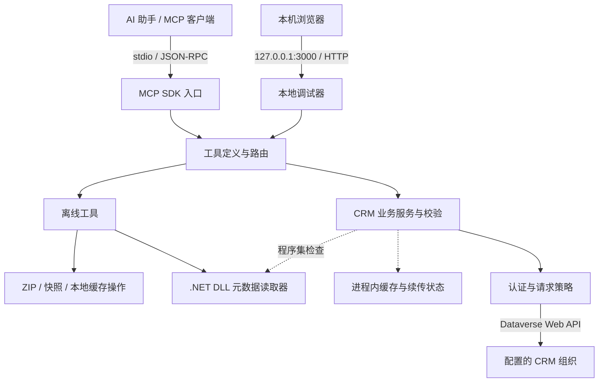
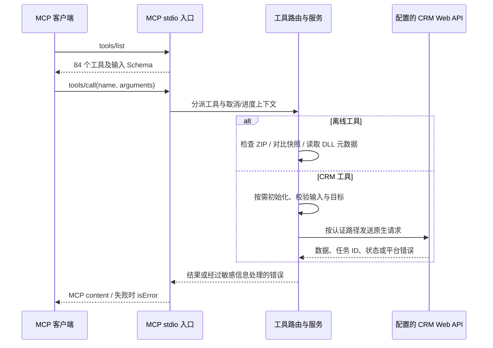
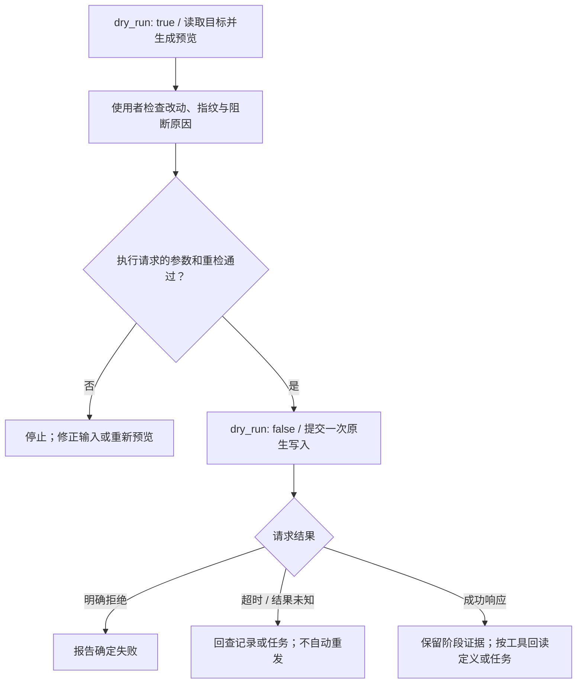
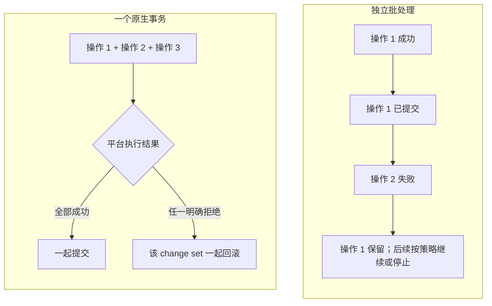
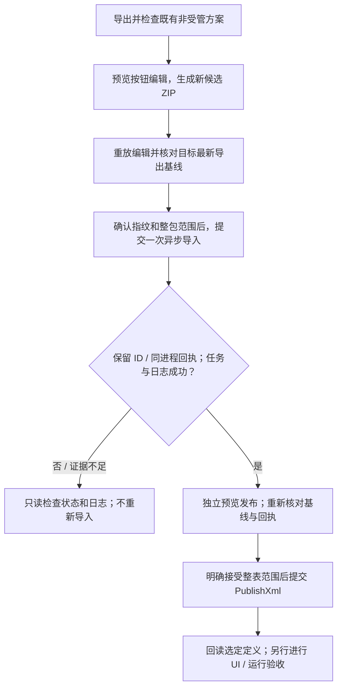

# Dynamics 365 MCP Server

**简体中文** | [English](README.en.md)

通过 Model Context Protocol（MCP），让 AI 助手查询和维护 Microsoft Dataverse / Dynamics 365 Customer Engagement。

项目使用 **TypeScript + Dataverse Web API**，提供 **84 个工具**，覆盖记录查询、数据变更、元数据、Web 资源、插件注册、数据模型、诊断审计、解决方案和经典 Ribbon 按钮。通过 **stdio** 接入 MCP 客户端，并提供本地 Web 调试界面。

**当前状态：**本地构建和 910 项回归通过。已实际调用 65/84 个工具；20 个工具的指定实写回读路径通过，2 个工具的发布请求已受理（页面效果未验收）。19 个尚未调用。所有本次新建的记录、脚本、表、字段、关系、键、选项集、方案及发布者均已清理，既有业务对象修改数为 0。完整验收仍受平台及能力限制，详见 [逐工具覆盖表](docs/CRM_TOOL_COVERAGE.md)。实际能力取决于 CRM 版本、定制支持及连接身份权限；不包含 Finance & Operations 或 Business Central。

[功能清单](#功能清单) · [架构与调用逻辑](#架构与调用逻辑) · [快速开始](#快速开始) · [认证配置](#认证配置) · [使用示例](#使用示例) · [写入与部署](#写入发布与结果判读) · [工具清单](#工具清单) · [测试与验证](#测试与验证)

## 功能清单

以下是代码已实现的能力，按使用场景归类。实现与本地测试通过，不代表已经完成真实 CRM 环境验收。

| 能力 | 工具数 | 主要用途 |
| --- | ---: | --- |
| 环境与基础元数据 | 8 | 用户与组织、环境能力、实体/字段/选项/导航关系、缓存清理 |
| 查询与分页 | 3 | OData、FetchXML、状态筛选、分页与结果续传 |
| 记录与事务 | 9 | CRUD、备用键 Upsert、关联/解除关联、批处理和原生事务 |
| Web 资源 | 4 | 查找、创建、更新及独立发布脚本等资源 |
| 插件注册 | 11 | 程序集检查与兼容更新、步骤注册/更新、Pre/Post Image 管理 |
| 诊断、安全与审计 | 9 | 插件跟踪、失败任务、主体/角色、有效权限和审计 |
| 数据模型与界面定义 | 20 | 表、列、关系、备用键、选项集、表单/视图结构及发布 |
| Action / Function | 2 | 从当前 CSDL 发现原生操作签名，校验参数并调用 |
| 解决方案 | 12 | 组件与依赖、ZIP 检查、导出/受限导入、任务状态、快照及验证 |
| 经典 Ribbon | 6 | 读取定义、编辑本地候选包、受控导入、独立发布与定义回读 |

工具发现使用 MCP `tools/list`，调用使用 `tools/call`。**84 是工具数量，910 是本地测试用例数量，二者不是同一口径。**真实联调按工具逐项跟踪，预览通过、本机夹具、空结果或有限读取不代表完整真实功能验收，见 [84 工具覆盖清单](docs/CRM_TOOL_COVERAGE.md)。详细参数和限制见 [工具参考](docs/TOOL_REFERENCE.md)。

### 查询、记录与运行证据

| 功能 | 可以完成的工作 | 主要边界 |
| --- | --- | --- |
| 环境检查 | 查看当前用户/组织、服务端版本及可见能力 | 元数据存在不代表具有写入权限 |
| 元数据查询 | 读取表、字段、必填级别、主键、选项标签及导航关系 | 依赖连接身份可见的元数据 |
| OData / FetchXML 查询 | 筛选、选择字段、排序、状态规则、格式化值、分页和续传 | 返回条数/页数有上限；续传状态在当前进程中 |
| 记录维护 | 按 ID 查询、创建、更新、删除；通过活动备用键 Upsert | 写入具有预检及适用的并发约束，不自动重试 |
| 记录关联 | 设置/清除 Lookup、建立/解除集合关系 | 解除关联不删除相关记录；集合关系需要明确接受并发边界 |
| 批量操作与事务 | 分块执行独立操作，或提交一个原生事务 change set | 独立批次不提供跨操作回滚；预检读取在事务外 |
| 插件故障诊断 | 读取诊断开关、插件跟踪与失败系统任务，关联步骤证据 | 只读分析，不自动修复或把关联当作根因 |
| 权限与审计 | 查看用户/团队/角色、有效记录权限及原生审计详情 | 不提升权限、不修改角色；审计旧/新值默认不展示 |

### 开发与定制

| 功能 | 可以完成的工作 | 主要边界 |
| --- | --- | --- |
| Web 资源 | 按名称查找、创建/更新内容、单独发布 | 保存与发布阶段分开报告；内容读取需显式开启 |
| 插件程序集 | 查询注册信息、检查本地 DLL、兼容更新既有程序集 | 不执行待检 DLL；不提供新程序集注册流程 |
| 插件步骤 | 发现消息/类型/过滤条件，查询、注册和更新步骤 | 注册使用已存在的插件类型；安全配置读取默认关闭 |
| 插件镜像 | 查询、注册、更新、删除 Pre/Post Image | 校验步骤适用性和字段清单，提供预览与并发检查 |
| 表与列 | 读取定义，创建表/受支持类型的列，维护标签与列设置 | 使用原生元数据操作及方案/发布者检查，不覆盖所有列类型 |
| 关系 | 读取/创建 1:N、Lookup、N:N，维护受支持的菜单与级联设置 | 受目标定义、可定制性与预览指纹约束 |
| 备用键 | 查看/创建键，为 Failed 状态的键重新提交索引任务 | 提交任务不代表索引已经可用 |
| 选项集 | 查看本地/全局选项、创建全局 Picklist、插入或更新选项标签、单独发布 | 不提供任意值删除/重编号；Boolean 保持 0/1 语义 |
| 表单与视图 | 读取保存/未发布定义，进行受支持的字段、库、事件和视图列/排序编辑 | 修改 XML 结构，不提供可视化设计器或任意布局改写 |
| Action / Function | 发现当前 CSDL 的操作、绑定、重载和参数类型后调用 | 不创建或修改 Custom API 定义；执行结果按原生响应报告 |

### 解决方案与经典 Ribbon

| 功能 | 可以完成的工作 | 主要边界 |
| --- | --- | --- |
| 方案与组件 | 列出方案/成员、查看依赖、将现有组件加入非受管方案 | 不创建缺失组件，不绕过平台依赖检查 |
| 本地 ZIP 检查 | 读取清单、文件信息及哈希，拒绝不受支持或损坏的包 | 无需 CRM；不解压执行包内容 |
| 方案导出 | 从普通非受管源导出 managed 或 unmanaged ZIP | 写入新本地文件，不覆盖原文件 |
| 首次方案导入 | 预览/提交首次普通非受管异步导入，按 ID 读取任务与日志 | 不支持通用既有方案更新、managed/补丁/升级导入；不自动发布 |
| 快照与验证 | 获取可见成员及选定属性快照、离线对比、核对目标环境 | 不是全量环境备份，也不证明运行行为一致 |
| Ribbon 定义读取 | 读取有效按钮、命令/规则引用、插入位置，检查方案内 RibbonDiffXml | 经典 Ribbon 范围，不覆盖完整现代命令设计器 |
| Ribbon 本地编辑 | 新增独立自定义 JS 按钮、修改标签/顺序、隐藏/恢复可见性，生成新候选 ZIP | 保留其他包内容；不自动导入、发布或执行 JavaScript |
| Ribbon 受控部署 | 对既有普通非受管方案导入候选包、独立整表发布、回读选定定义 | 整包/整表范围需明确确认；同进程回执；不代替按钮页面验收 |

## 架构与调用逻辑

### 整体架构

MCP stdio 入口和本地 HTTP 调试器共享工具注册与路由。路由将离线工具直接交给本地处理器；CRM 工具则按需创建服务，通过同一 Web API 客户端访问配置的组织。



配置、缓存、续传状态和 Ribbon 导入回执属于服务进程的状态，不是跨进程持久化工作流。`.NET` 读取器只服务于相应的程序集检查/更新路径，其余 CRM 工具不依赖它。

### 一次工具调用如何完成

下图展示工具发现及成功调用路径；配置、参数或平台校验失败时提前返回错误，不会越过相应检查继续提交。



## 快速开始

### 1. 准备运行环境

| 组件 | 要求 |
| --- | --- |
| Node.js | package.json 声明 `>=18`；本轮实测 **24.18.0、24.22.1**，Node 18 下限尚未实机验证 |
| npm | 用于源码安装、构建与测试；仓库包含 package-lock.json |
| .NET 10 Runtime | 本地 DLL 检查/程序集更新及完整测试需要；其余工具和程序集元数据查询无需 .NET |
| .NET 10 SDK | 重建程序集读取器、`build:release` 或 `npm pack` 时需要 |
| CRM 连接 | 调用 CRM 工具时需要；工具发现、缓存清理及部分离线工具无需连接 |

本地 DLL 检查使用固定的 .NET 元数据读取器，不执行被检查的插件 DLL。读取器的 .NET 10 要求与目标 CRM 插件的框架要求是两回事。dotnet 不在 PATH 时，可用 `D365_DOTNET_PATH` 指定其可执行文件绝对路径。

### 2. 获取并构建源码

将 `YOUR_ACCOUNT/YOUR_REPOSITORY` 替换为实际 GitHub 仓库地址：

```bash
git clone https://github.com/YOUR_ACCOUNT/YOUR_REPOSITORY.git dynamics365-mcp-server
cd dynamics365-mcp-server
npm ci
npm run build
```

`npm run build` 先进行 TypeScript 类型检查，再生成包含运行依赖的 `dist/index.cjs`，并使用仓库现有的程序集读取器。如需一并重建读取器，执行 `npm run build:release`。

### 3. 接入 MCP 客户端

在支持 stdio MCP 的客户端中添加服务器。下面适用于采用 `mcpServers` 格式的客户端；其他客户端请使用其对应配置入口。

```json
{
  "mcpServers": {
    "dynamics365": {
      "command": "node",
      "args": ["D:/projects/dynamics365-mcp-server/dist/index.cjs"],
      "env": {
        "AUTH_TYPE": "online",
        "ORG_URL": "https://your-org.crm.dynamics.com",
        "TENANT_ID": "YOUR_TENANT_ID",
        "CLIENT_ID": "YOUR_CLIENT_ID",
        "CLIENT_SECRET": "YOUR_CLIENT_SECRET",
        "API_VERSION": "v9.2"
      }
    }
  }
}
```

将 `args` 改为构建文件的**绝对路径**，替换连接参数。Windows JSON 路径可使用 `/`；使用反斜杠时需要写成 `\\`。客户端找不到 node 时，将 `command` 改为 Node 可执行文件的绝对路径。

保存配置并重启客户端中的 MCP 服务，确认能发现 **84 个工具**。然后调用 `get_current_user_context`、`get_environment_capabilities` 检查身份与环境信息；环境能力读取不能代替实际权限和写入验收。

CRM 服务按需初始化：缺少连接配置也能启动并列出工具，首次 CRM 调用才校验配置。修改环境变量后需要重启服务。

### 使用已有构建产物

如果已经取得本项目的构建包，解包后可直接运行：

```bash
node /absolute/path/to/package/dist/index.cjs
```

已构建的 bundle 无需额外安装 node_modules；DLL 检查功能仍需要 .NET Runtime。stdio 服务启动后会等待 MCP 协议输入，不会打开网页；本地调试界面见下文。

## 认证配置

实现包含三条认证路径，均使用 Dataverse Web API。AD/NTLM 已完成一次 CRM 9.1 基础只读联调；Online 和 IFD 尚未完成真实环境联调。

### Online：OAuth 2.0 客户端凭据

| 变量 | 说明 |
| --- | --- |
| `AUTH_TYPE` | `online`，也是默认值 |
| `ORG_URL` | 组织根地址，例如 `https://your-org.crm.dynamics.com` |
| `TENANT_ID` | 租户 ID、域名或受支持的 authority URL |
| `CLIENT_ID` | 应用客户端 ID |
| `CLIENT_SECRET` | 应用客户端密钥 |

`ENVIRONMENT_URL` 可作为组织地址别名；同时配置它和 `ORG_URL` 时，两者必须指向同一组织。组织地址不应包含 `/api/data/v9.2`、凭据、查询串或 fragment。连接身份需要具备目标环境中相应的数据、元数据和定制权限。

### 本地部署：AD / NTLM

在 MCP 客户端的 `env` 中使用：

```json
{
  "AUTH_TYPE": "op_ad",
  "ORG_URL": "https://crm.example.com/YourOrg",
  "AD_DOMAIN": "YOUR_DOMAIN",
  "AD_USERNAME": "YOUR_USERNAME",
  "AD_PASSWORD": "YOUR_PASSWORD",
  "API_VERSION": "v9.1"
}
```

`AD_WORKSTATION` 为可选项。根据服务端实际可用的 Web API 版本设置 `API_VERSION`。

### 本地部署：IFD / ADFS

```json
{
  "AUTH_TYPE": "op_ifd",
  "ORG_URL": "https://your-org.example.com",
  "IFD_ADFS_URL": "https://adfs.example.com",
  "IFD_CLIENT_ID": "YOUR_ADFS_CLIENT_ID",
  "IFD_USERNAME": "YOUR_USERNAME",
  "IFD_PASSWORD": "YOUR_PASSWORD",
  "API_VERSION": "v9.1"
}
```

可选项有 `IFD_CLIENT_SECRET`、`IFD_RESOURCE` 和 `IFD_TOKEN_PATH`。resource 默认使用组织地址，token path 默认为 `/adfs/oauth2/token`。当前只实现 `password` grant，未实现交互式登录。

### 通用设置

| 变量 | 默认值 | 说明 |
| --- | --- | --- |
| `API_VERSION` | `v9.2` | 例如 v9.1、v9.2；不会自动探测并切换版本 |
| `CACHE_TTL` | `7200` | 缓存秒数，非负整数；0 表示缓存不按 TTL 自动过期 |
| `CACHE_TTL_SECONDS` | — | CACHE_TTL 的兼容别名；两者同时设置时 CACHE_TTL 优先 |
| `REQUEST_TIMEOUT_MS` | `30000` | 单次 HTTP 请求超时，范围 1–300000 ms |
| `MAX_READ_RETRIES` | `2` | GET 暂态故障重试上限，范围 0–5 |
| `MAX_RETRY_DELAY_MS` | `30000` | 可等待的重试延迟上限，范围 0–300000 ms |
| `D365_DOTNET_PATH` | `dotnet` | 可选的 .NET 可执行文件路径 |

本地开发可在项目根目录创建 `.env` 并写入同名变量；MCP 客户端也可直接注入环境变量，无需 `.env`。示例均为占位符，不要把实际密钥、密码、token、客户数据或含敏感内容的方案包提交到仓库或 Issue。

## 使用示例

以下 JSON 是 `tools/call` 的 `params`，实际调用由 MCP 客户端发送。

### 查询记录

```json
{
  "name": "search_records_by_odata",
  "arguments": {
    "collection_name": "accounts",
    "select": "accountid,name",
    "state_mode": "all",
    "page_size": 100,
    "max_records": 100,
    "fetch_all": false
  }
}
```

`collection_name` 使用原生 EntitySetName，如 `accounts`；元数据工具通常使用表逻辑名，如 `account`。查询返回 `value`、实际查询说明 `query` 和分页信息 `paging`。

默认 `state_mode=legacy`：当表具有 statecode=0 且没有明确的根级状态条件时，可能补充该筛选。0 并不代表所有表的“启用”。若要避免额外加入状态条件，显式使用 `state_mode: "all"`；它不会删除已写在查询中的条件。

结果续传使用返回的 `continuation`，后续调用不要重复筛选/XML/分页参数。续传状态保存在当前服务进程中，重启、清理缓存或过期后需要重新查询。

### 预览记录更新

```json
{
  "name": "update_existing_record",
  "arguments": {
    "collection_name": "accounts",
    "id": "aaaaaaaa-aaaa-aaaa-aaaa-aaaaaaaaaaaa",
    "data": {
      "name": "Updated account name"
    },
    "dry_run": true
  }
}
```

将 ID 替换为实际记录 ID，检查预览的目标、改动和阻断原因，再按该工具要求执行。不同工具的预览默认值和并发保护要求不同，详见下节。

### 无 CRM 配置检查本地方案包

```json
{
  "name": "inspect_solution_package",
  "arguments": {
    "file_path": "D:/solutions/MySolution.zip"
  }
}
```

路径指向 **MCP 服务所在机器**。该工具检查有大小和格式边界的 ZIP，不将内容解压到目标目录，也不会执行包内代码。`compare_solution_snapshots`、`inspect_ribbon_solution`、`edit_ribbon_solution` 和 `d365_plugin_assembly_inspect` 也支持相应的本地流程，其中 DLL 检查需要 .NET Runtime。

## 写入、发布与结果判读

工具集包含真实写入能力，**并非所有工具都默认预览**：

| 工具范围 | 默认行为 |
| --- | --- |
| 记录变更、Web 资源创建/更新、插件步骤注册/更新、`call_d365_api_action` | 保留直接执行行为；预览需显式传入 `dry_run: true` |
| 数据模型维护、插件镜像/程序集更新、方案组件添加、方案导出/导入、Ribbon 编辑及受控部署 | 提供默认预览流程；执行参数和所需指纹以工具 Schema 与预览结果为准 |
| 独立发布工具 | 部分直接发布、部分默认预览；不要推断与创建/更新工具相同 |

- **保存与发布分开。** Web 资源创建/更新默认可继续发布；模型、方案和 Ribbon 工具各自定义发布范围。保存成功不等于已经发布。
- **预览指纹不等于锁。** 部分操作要求将预览的 planHash 或 definitionHash 作为 `expected_hash` 回传，需要时还必须显式允许 `allow_unprotected_write`。指纹不能消除平台的全部并发窗口。
- **写入不自动重试。** 应用层不会因超时、401、限流或服务端错误自动重复写入。`outcome: "unknown"` 表示结果需要回查，不能直接当作未执行。
- **批处理与事务不同。** `execute_record_batch` 中已成功的操作不会因后续失败一起回滚；`execute_record_transaction` 使用一个原生 change set。事务外的预检读取不受事务保护。
- **异步接受不等于完成。** 导入、索引等操作需要核实原生任务状态；定义回读一致也不等于客户端运行验收通过。

### 预览到执行的控制流程

以下适用于提供预览能力的 CRM 写入。它描述显式采用 `dry_run: true` 的流程，不改变前述直接执行工具的默认值；各工具是否要求指纹、确认参数及回读，以其 Schema 和返回结果为准。



### 批处理与事务的区别

独立批处理（`execute_record_batch`）让每个操作拥有自己的 change set；事务（`execute_record_transaction`）把多个操作放入同一个 change set。下图的提交/回滚针对平台明确确认的结果；传输中断或结果未知时仍需回查。



### Ribbon 从本地编辑到受控部署

经典 Ribbon 当前限于受支持的自定义按钮结构和普通非受管方案流程。`import_solution_async` 仅支持首次普通非受管导入；既有非受管 Ribbon 方案走单独的 `import_ribbon_solution`。

Ribbon 导入作用于**整个方案包**，发布作用于**整张表**，可能包含其他组件或待发布定制；执行时需分别明确允许 `allow_full_solution_import` / `allow_full_table_publish`。导入到发布使用当前服务进程的回执，重启后不能靠重新导入重建回执。引用的 JavaScript/图片资源不会被该 Ribbon 发布请求自动发布。

当前不提供通用 managed/升级/补丁导入、自动回滚、Custom API 定义维护或现代命令设计器的完整管理。Action/Function 调用支持以当前 CSDL 可发现的签名为准。



图中的状态核查由调用者触发，不代表后台自动轮询。`verify_ribbon_deployment` 可独立执行只读定义检查，不会自动修复或重发部署；定义匹配仍不证明按钮已通过 UI/运行验收。

## 工具清单

<details>
<summary>展开全部 84 个工具</summary>

### 环境与基础元数据（8）

- `get_environment_capabilities`
- `get_current_user_context`
- `list_all_entity_definitions`
- `get_entity_metadata_summary`
- `get_detailed_field_metadata`
- `get_field_picklist_options`
- `get_entity_navigation_links`
- `clear_server_cache`

### 查询与分页（3）

- `search_records_by_odata`
- `preview_fetchxml_query`
- `query_by_fetchxml`

### 记录与事务（9）

- `get_record_by_id`
- `create_new_record`
- `update_existing_record`
- `delete_record_by_id`
- `upsert_record_by_key`
- `associate_records`
- `disassociate_records`
- `execute_record_batch`
- `execute_record_transaction`

### Web 资源（4）

- `search_web_resources_by_name`
- `create_web_resource_and_publish`
- `update_web_resource_and_publish`
- `publish_web_resource`

### 插件注册（11）

- `d365_plugin_registration_metadata`
- `d365_plugin_steps_query`
- `d365_plugin_step_register`
- `d365_plugin_step_update`
- `d365_plugin_images_query`
- `d365_plugin_image_register`
- `d365_plugin_image_update`
- `d365_plugin_image_delete`
- `d365_plugin_assemblies_query`
- `d365_plugin_assembly_inspect`
- `d365_plugin_assembly_update`

### 诊断、安全与审计（9）

- `get_diagnostic_settings`
- `query_plugin_trace_logs`
- `query_failed_system_jobs`
- `diagnose_plugin_failure`
- `query_security_principals`
- `get_principal_security_context`
- `get_record_access`
- `get_record_audit_history`
- `get_audit_details`

### 数据模型与界面定义（20）

- `get_model_definition`
- `create_model_table`
- `create_model_column`
- `update_model_labels`
- `publish_model_table`
- `get_model_relationship`
- `create_model_relationship`
- `get_model_key`
- `create_model_key`
- `update_model_column_settings`
- `update_model_relationship`
- `reactivate_model_key`
- `get_model_choices`
- `create_model_choices`
- `change_model_choice_value`
- `publish_model_choices`
- `list_model_ui_components`
- `get_model_ui_component`
- `edit_model_form`
- `edit_model_view`

### Action / Function（2）

- `get_api_operation`
- `call_d365_api_action`

### 解决方案（12）

- `list_solutions`
- `list_solution_components`
- `get_solution_component_dependencies`
- `add_solution_component`
- `inspect_solution_package`
- `export_solution`
- `import_solution_async`
- `get_solution_import_status`
- `get_solution_snapshot`
- `compare_solution_snapshots`
- `verify_solution_deployment`
- `get_solution_import_log`

### 经典 Ribbon（6）

- `get_ribbon_definition`
- `inspect_ribbon_solution`
- `edit_ribbon_solution`
- `import_ribbon_solution`
- `publish_ribbon_solution`
- `verify_ribbon_deployment`

</details>

完整参数、兼容别名、格式限制和结果解释见 [详细工具参考](docs/TOOL_REFERENCE.md)。实现位于 [src/tools](src/tools) 和 [src/tool_handler.ts](src/tool_handler.ts)。

## 本地调试

配置环境变量或本地 `.env` 后运行：

```bash
npm run debug
```

浏览器打开 `http://localhost:3000`。调试器仅监听 `127.0.0.1:3000`，可查看工具、填写参数和查看调用结果。它与 MCP 服务具有相同的本机文件访问能力和 CRM 权限，界面调用也可能执行真实写入。

调试器提供 Host/Origin 校验、请求体限制和静态路径保护，请保持本机使用。主 MCP 传输仍为 stdio，本项目没有提供远程 HTTP/SSE MCP 服务。

## 测试与验证

最近一次全面本地测试：**2026-10-29**。

| 项目 | 结果 |
| --- | --- |
| 隔离安装与发布构建 | 通过；离线安装 192 个依赖，.NET 构建零警告/错误 |
| 完整回归 | **910 项通过**，零失败、零跳过；28 个测试文件 |
| 工具契约 | 84 个输入 Schema 编译成功，工具名称唯一，测试文件发现一致 |
| ZIP 健壮性 | 256 个固定种子截断/变异样本均按预期拒绝 |
| 实际本机 HTTP | 10 项通过，另有进程内 handler 回归 |
| 解包后的 stdio / CLI | Node 24.18.0、24.22.1 上各通过 14 项启动检查，无需 node_modules |
| 已加载 TypeScript 源码覆盖率 | 行 98.71%、分支 90.61%、函数 97.21% |
| 真实 CRM 联调 | CRM 9.1.7.5 / API v9.1 / AD/NTLM；65/84 工具已调用，20 个指定实写回读路径通过，2 个发布请求受理；所有新建对象已清理 |

覆盖率统计已加载的 72 个 TypeScript 源文件，不包含未加载源码、子进程 bundle 或 .NET 代码。两个运行时的启动检查与主套件存在场景重叠，不应累加成互不重复的功能测试数量。

上述 910 项回归使用离线夹具和请求替身；真实 CRM 结果另见 [逐工具状态与阻断说明](docs/CRM_TOOL_COVERAGE.md)。解除关联仍出现 HTTP 204 但关联未清除，现明确报告 READBACK_MISMATCH；CSDL /$metadata 仍因服务端缓存文件权限返回 500。新建键索引在有界回查中持续 Pending，Upsert 预览被活动键规则阻断；IsCustomizable=false 另阻断重新激活预览。默认非等宽表单区块的字段添加被明确拒绝，添加脚本库路径已单独验证。未调用项包括 CSDL 依赖、插件实写所需可部署 DLL/注册样本和仅由本地套件验证的纯本机工具；键 Upsert 状态见逐项表。其他认证方式、更广泛权限、并发/异常场景、插件执行及 Ribbon 显示/点击仍待验收；未进行联网依赖漏洞审计或生产压力测试。

在源码目录复现：

```bash
npm ci
npm run build:release
npm test
npm run test:contracts
```

真实回环 HTTP 检查可单独运行 `node scripts/qa-debug-socket.mjs`，需要 3000 端口空闲。测试位于 [tests](tests)，补充契约检查位于 [scripts/qa-local.mjs](scripts/qa-local.mjs)。

## 开发与构建

| 命令 | 作用 |
| --- | --- |
| `npm run dev` | 通过 tsx 从源码启动 stdio 服务 |
| `npm run watch` | 监听源码变化并重新运行 |
| `npm run typecheck` | TypeScript 类型检查 |
| `npm run build` | 类型检查并构建 Node bundle |
| `npm run build:inspector` | 使用 .NET 10 SDK 重建程序集元数据读取器 |
| `npm run build:release` | 重建读取器、类型检查并构建 bundle |
| `npm start` | 启动 dist/index.cjs |
| `npm test` | 完整本地回归 |
| `npm run test:smoke` | 启动与 stdio/CLI 检查，需要先构建 |
| `npm run test:contracts` | Schema、测试文件纳入情况和 ZIP 变异检查 |
| `npm run debug` | 启动本地 Web 调试器 |
| `npm pack` | 自动执行发布构建并生成本地 npm tarball，需要 .NET 10 SDK |

生成本地 tarball 不代表已发布到 npm。运行入口为 `dist/index.cjs`，CLI 入口为 `bin/dynamics365-mcp-server.js`；CLI 在同一 Node 进程中加载服务，stdout 保留给 MCP 协议，运行日志写入 stderr。

```text
src/
  index.ts                 MCP stdio 入口
  tool_handler.ts          工具注册与路由
  config.ts                配置读取与校验
  errors.ts                结构化错误与敏感信息处理
  tools/                   工具描述与输入 Schema
  services/                Web API、业务服务与本地包处理
  debug/                   本地 HTTP 调试器及界面
bin/                       CLI 与程序集元数据读取器
tools/assembly-inspector/  .NET 读取器源码
scripts/                   构建与补充验证脚本
tests/                     回归测试与离线夹具
docs/                      详细工具参考
```

## 常见问题

**能看到工具，但提示 `D365_CONFIG_INVALID`？** 服务器允许无配置启动；根据错误提示补齐环境变量并重启。Online 同时设置两个组织地址时需要保持一致。

**认证失败或返回 403？** `D365_AUTH_FAILED` 表示需要检查身份配置及连接；403 还需要核实目标环境权限。工具不会绕过平台授权，重试不能替代权限配置。

**缺少 dist/index.cjs？** 克隆源码后先运行 `npm ci` 和 `npm run build`，确认客户端使用构建文件的绝对路径。

**DLL 检查失败？** 检查 .NET 10 Runtime，必要时配置 `D365_DOTNET_PATH`。只查询程序集元数据不需要启动读取器。

**出现 `D365_QUERY_CONTINUATION_EXPIRED`？** 续传状态不跨进程保存，重启、清理缓存或过期后重新查询。

**写入超时后能否再提交？** 先按返回的阶段信息、任务 ID 或目标记录回查。结果未知时重复提交可能造成重复变更。

## 参与贡献

欢迎通过 Issue 提交可复现问题，通过 Pull Request 改进代码与文档。请提供复现步骤、Node/.NET 版本、认证类型、API 版本和脱敏错误码；不要附带实际凭据或客户数据。

修改工具时同步维护 Schema、实现、回归测试和文档。提交前运行 `npm run build:release`、`npm test` 和 `npm run test:contracts`。涉及真实平台行为的变更，请说明测试环境、验证步骤及尚未验证的部分。

## 许可证

当前 [package.json](package.json) 中的许可证声明为 **MIT**，源码目录尚未包含 LICENSE 正文；正式开源发布前需要补齐许可证文件，并确认所包含代码与第三方依赖的授权说明。
