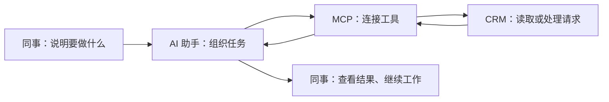

# 让 AI 帮我们查 CRM、改配置、整理交付材料

> 公司内部分享 · 约 5 分钟读完

做 CRM 项目时，我们常遇到一些不难、却很费周折的事：找一个字段、检查一张表单、整理一次报错，或者把需求讨论重新排成文档。

**Dynamics 365 MCP 是一个让 AI 助手连接 CRM 的工具。接入后，我们可以用日常语言提出任务，让 AI 帮忙查询实际配置、准备变更，并返回操作结果。**

对使用者来说，最直接的变化是：在对话里就能拿到环境中的实际信息，并围绕这些信息继续工作。

## 先看一个完整例子

假设你收到一个需求：

> “在客户页面上加一个‘客户分级’，让销售能选择普通客户或重点客户。”

通常，我们要先找客户表，确认有没有类似字段，再找到对应表单，决定是复用字段还是新建，最后保存、发布并检查页面。

接入这个工具后，可以把工作分成下面三步。

**以下对话和结果均为虚构示例，用来说明使用方式；不表示已经在真实环境执行。**

### 第一步：让 AI 先查现状

你可以说：

> 请在测试环境中检查：“客户分级”这个字段是否已经存在？客户主表单上有没有显示？先只查询，不修改。

AI 读取配置后，可以整理出这样的回答：

> 已经有“客户分级”字段，选项是“普通客户”和“重点客户”。
>
> 但指定的客户主表单还没有显示它。
>
> 建议复用现有字段，将它加到这张表单，不需要重复创建。

**你得到的是一个可以据此做决定的结论：字段已有，只需补充页面显示。** 如果有多个同名字段或多张表单，AI 应先列出候选，让你确认。

### 第二步：先看准备怎么改

接着说：

> 请先展示把这个字段加入指定主表单的修改方案，暂时不要保存或发布。

对于工具支持的表单布局，AI 可以准备变更预览，说明要修改哪张表单、增加哪个字段，以及拟放置的位置。

你审阅的是具体修改，例如：

| 项目 | 本次计划 |
| --- | --- |
| 修改对象 | 测试环境中已选定的客户主表单 |
| 修改内容 | 增加已有“客户分级”字段的显示 |
| 执行情况 | 当前仅预览，尚未保存或发布 |

如果现有布局不支持，工具会返回限制，再由开发人员处理。

### 第三步：确认后执行，再到页面检查

确认方案符合需求后，再让 AI 执行对应的保存和发布步骤。

完成后，请它分别报告：

- 表单是否保存成功；
- 发布是否成功；
- 重新读取的表单定义中是否有这个字段；
- 哪些页面效果还需要人检查。

最后，我们进入测试页面，确认字段是否出现在预期位置、选项是否正确、是否能正常保存记录。

**这件事的解决效果是：先查清现状，避免重复建字段；把修改方案摆出来审阅；执行后明确告诉我们完成了什么、还要检查什么。**

## 除了这个例子，还能帮什么忙？

先记住下面四类任务就够了，不需要记工具名称。

| 你想做的事 | 可以怎样提问 | 能得到什么 |
| --- | --- | --- |
| 查配置、查数据 | “这个页面上的字段是什么？查一下满足条件的客户。” | 字段信息、选项说明或查询结果；有重名、权限或数量限制时一起说明 |
| 整理故障线索 | “这个时间段保存失败了，帮我查相关日志。” | 可读取的报错、失败任务和关联线索，供开发继续定位；不保证每次都能直接找到根因 |
| 准备和执行定制变更 | “先预览这段脚本或表单准备改哪里。” | 修改预览、保存和发布结果；部分方案及按钮工作也有对应流程，具体范围见技术附文 |
| 整理项目交付材料 | “把这些验收场景整理成 UAT 表格。” | 可编辑的 Word、Excel 或离线页面原型，供项目组继续评审和修改 |

最后一类属于需要单独启用的本地顾问模块。它根据提供的内容生成文件；生成 UAT 表格不等于自动执行验收测试。

## 它为什么能做到这些？

因为 AI 除了理解我们的描述，还可以通过这个连接工具读取 CRM，并调用受支持的操作。

“MCP”是这类连接方式的名称。日常使用时，不需要先学会接口或编程，但需要把目标环境、对象和允许的操作说清楚。

工具使用配置账号的 CRM 权限：账号没有权限的操作，AI 也不能凭空完成。

## 怎么提问，比较容易得到有用的结果？

把这四件事说清楚：**在哪个环境、处理哪个对象、现在允许做什么、希望得到什么结果。**

可以直接参考下面这段：

> 在测试环境，检查客户主表单上的“客户分级”字段。
>
> 先只查询，告诉我字段是否存在、有哪些选项、表单是否已经显示。
>
> 如果涉及修改，先展示修改方案，等我确认后再执行。
>
> 最后用通俗语言说明查询到了什么，以及还有什么没确认。

尽量一次完成一个明确任务。先查清楚，再决定是否修改，比把整份需求一次性交给 AI 更容易审阅。

## 使用时，记住三件事

**先确认环境。** 第一次试用从测试环境和只读查询开始。不要只凭对话里的环境名称判断，要核对实际连接信息。

**修改前先看方案。** 部分工具可以直接执行，不能假定每次都会弹出确认。对话要求之外，管理员还可以限制开放的工具和账号权限。

**执行后还要验收。** “保存成功”“发布成功”和“页面上符合业务要求”是不同的事。超时或取消后，先查询实际结果，不要立即重复整套操作。

另外，CRM 查询结果会返回 AI 客户端。使用哪种客户端和模型、哪些客户数据可以进入对话，应遵循公司的数据管理要求。

## 想试用，从这里开始

先由接入同事配置好公司允许使用的 AI 客户端、测试环境和个人所需权限。接入完成后，可以从一个简单任务开始：

> 请先告诉我实际连接的是哪个 CRM 环境，然后查询客户表上的几个主要字段。只读，不修改。

第一次体验重点看三件事：**是否查到了实际信息、回答是否容易理解、结果能否支持下一步工作。**

如果要在团队中评价效果，可以挑一个平时经常做的小任务，记录原来的操作过程，再对照接入后的过程。本文没有统一计时数据，也不承诺固定的效率提升比例。

## 需要接入或了解更多

- [中文说明：安装、配置与完整功能](https://github.com/Kenny-666/Dynamics365-mcp-server/blob/main/README.zh-CN.md)
- [分享附文：接入、工具范围和技术细节](https://github.com/Kenny-666/Dynamics365-mcp-server/blob/main/docs/INTERNAL_SHARING_TECHNICAL.zh-CN.md)
- [项目仓库与发行包](https://github.com/Kenny-666/Dynamics365-mcp-server)

> 本文基于 v1.1.1，更新于 2026-11-03。功能是否适用，需要在实际环境确认；完整工具范围、本地测试和真实联调记录见说明文档。
