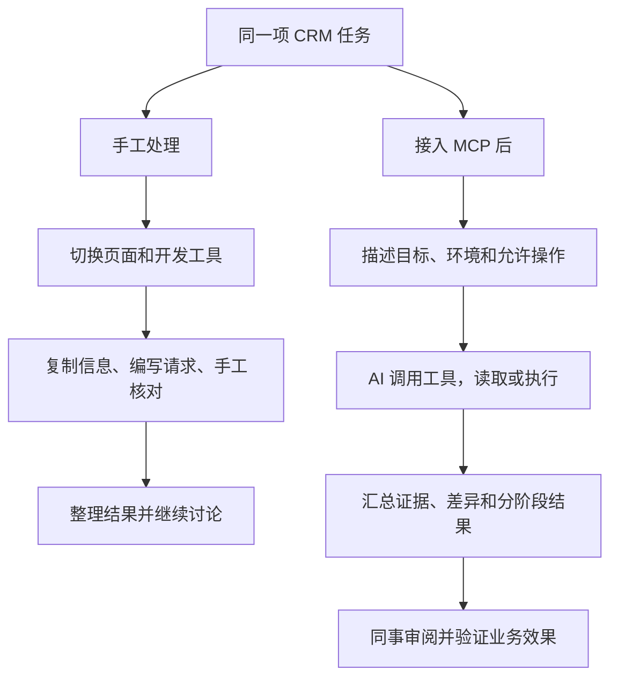
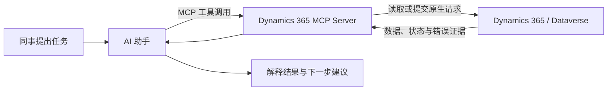
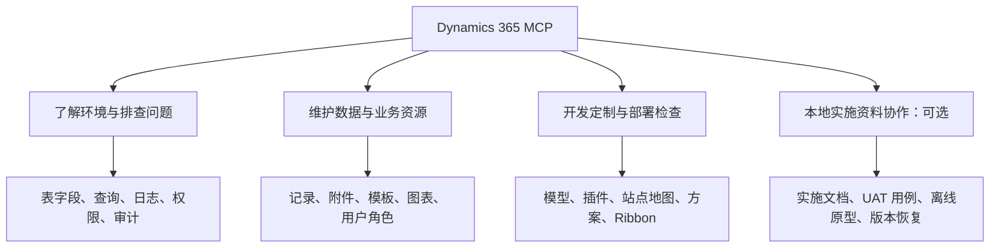
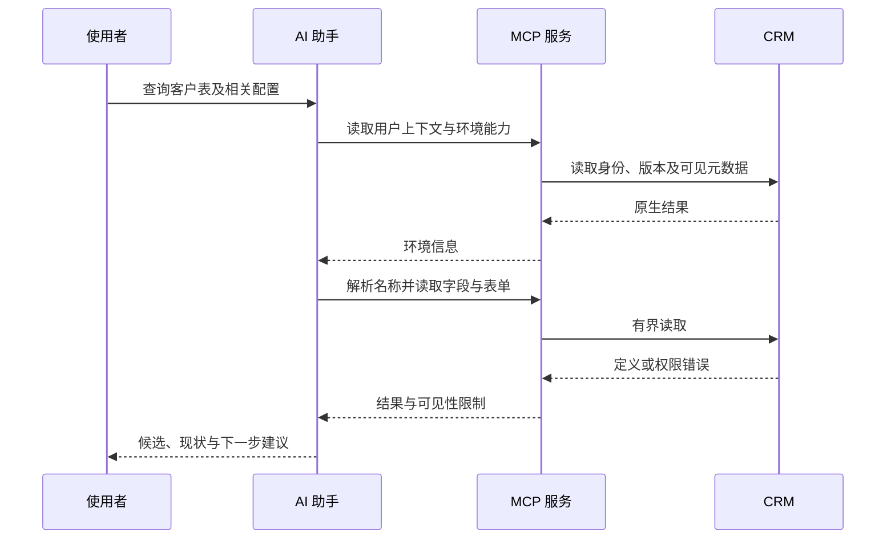
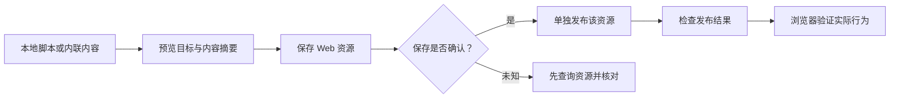
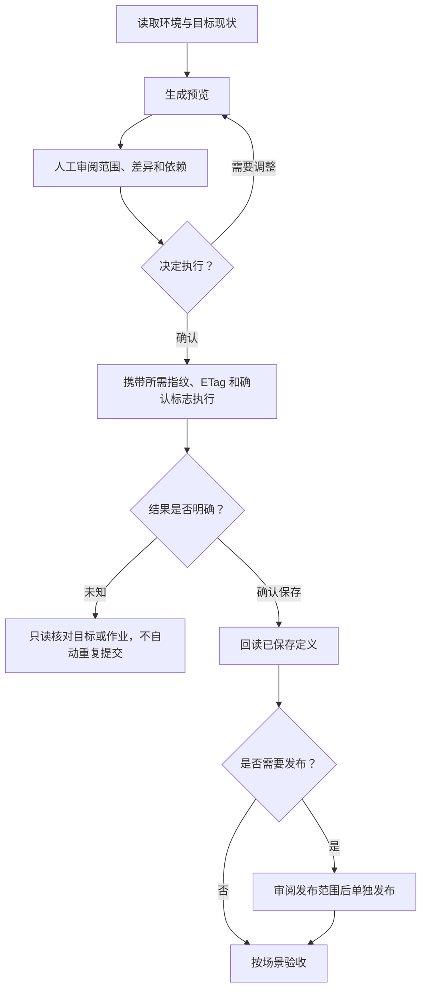
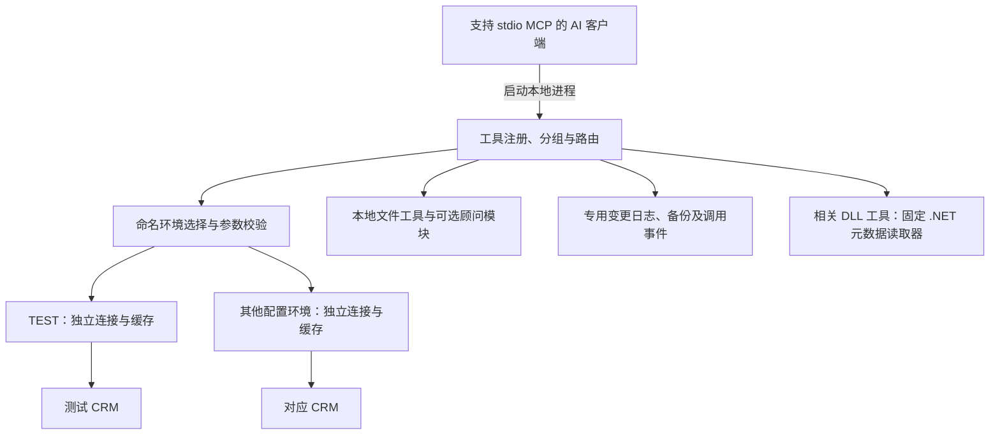

# Dynamics 365 MCP：接入与技术说明（分享附文）

> 本文为内部分享的技术附文，供需要了解配置、工具范围、部署和验证细节的同事查阅。
>
> 面向实施顾问、CRM 开发、测试和运维同事。建议阅读时间：约 12–15 分钟。
>
> 文档基于 **v1.1.1**，更新于 **2026-11-03**。

## 先看解决效果：用完之后，我们能拿到什么？

**接入 Dynamics 365 MCP 后，可以让 AI 读取目标环境、执行受支持的操作，并把查询证据、变更结果和待验收事项整理出来。** 同事可以据此判断下一步该怎么做，并核对操作是否达到预期。

| 日常任务 | 原来的处理过程 | 接入后能得到的具体结果 | 怎么确认有用 |
| --- | --- | --- | --- |
| 查清“客户分级”对应什么字段 | 找表、翻字段配置、复制逻辑名和选项，再交给开发使用 | 目标表逻辑名、集合名、字段类型、必填性及选项值的汇总；名称重名时列出候选 | 与目标环境元数据核对，确认字段可用于查询或后续开发 |
| 排查一次插件失败 | 分别查插件跟踪、失败任务和步骤，再手工串联线索 | 时间范围内的跟踪/作业清单、原生关联关系、当前步骤信息，以及证据缺口 | 能定位到具体记录和步骤，明确哪些原因仍需验证 |
| 更新一个 Web 资源 | 手工定位、上传、保存、发布，再判断失败发生在哪一步 | 更新前预览，以及保存、资源 ID、发布各阶段的结果；发布失败时保留已保存证据 | 核对资源内容和发布结果，再在页面验证脚本行为 |
| 比较两个环境的方案 | 分别导出或查询组件，人工核对名称、版本及内容 | 选定组件范围的缺失、额外、属性或内容哈希差异，以及不完整项 | 每项差异能追溯到组件；没有覆盖的内容不会当成一致 |
| 修改一个经典 Ribbon 按钮 | 修改方案 XML、打包、导入、发布，再到页面检查 | 新的候选 ZIP、修改前后摘要、其他内容保留检查，以及受控导入/发布和按钮定义回读结果 | 审阅包内变更，确认作业、发布及定义结果，再进行页面验收 |
| 整理实施方案或 UAT | 将讨论结果重新排成 Word、Excel 或演示页面 | 根据结构化输入生成可编辑 DOCX、UAT XLSX 或离线 HTML，并保留资产版本 | 打开文件检查内容，交给项目成员继续编辑和评审 |

### 一个具体例子：避免把已经存在的字段再建一遍

假设需求是：“给客户表加一个客户分级字段，并放到主表单上。”先让 AI 查询实际配置，它可以将工具结果整理成这样的结论：

> **以下为虚构的汇总展示示例，用于说明结果形态；不是实际环境查询结果，也不是 MCP 原始响应格式。**

```text
目标环境：TEST
目标表：客户（account），集合名 accounts
已有字段：客户分级（demo_customergrade），类型为单选项
当前表单：示例主表单尚未放置该字段

处理建议：复用已有字段，先预览将它加入指定表单的变更。
本轮操作：只读查询，未创建字段、未保存表单、未发布。
待确认：具体选用哪个主表单，以及字段的展示位置。
```

这个结果可以直接推动需求讨论：**先确认现状，再决定复用字段还是创建字段，并把后续变更范围缩小到具体对象。**

### 工作方式发生了什么变化



可观察的效果是：查配置能得到可复用的字段信息，排错能得到关联证据，变更能得到可审阅的预览与结果，资料整理能得到可编辑文件。**团队尚未做统一计时对照，因此本文不承诺“节省多少分钟”或“效率提升多少百分比”。**

## 1. MCP 在这里做什么

MCP，即 Model Context Protocol，是 AI 客户端连接外部工具的一种标准协议。在本项目中，可以把它理解为 AI 助手与 CRM 之间的工具接口。

用户描述任务，AI 选择工具并填写参数；MCP 服务负责校验参数、选择环境、调用 CRM API，再把结果交回 AI 解释。



这里有三个角色需要区分：

| 角色 | 负责什么 |
| --- | --- |
| AI 助手 | 理解任务、组织调用、解释结果；任务描述不清时仍可能选错工具或参数 |
| MCP 服务 | 暴露工具和输入约束，执行校验、请求及结果处理 |
| CRM 平台 | 根据连接身份、业务规则和平台能力决定实际操作是否允许、是否成功 |

**工具不会绕过 CRM 权限。** 同一句自然语言在不同环境、账号或版本下，可能得到不同结果。

## 2. 它已经能做哪些事

当前默认提供 **116 个工具**，另有 **1 个需要显式启用的本地实施顾问工具**。工具数量是接口数量，不能直接理解为功能验收数量。

按工作场景，可以把这些能力分成四条主线：



### 2.1 了解环境与排查问题

| 能力 | 典型问题 | 代表工具 |
| --- | --- | --- |
| 环境与元数据 | 当前连接谁？有哪些表、字段和选项？ | `get_environment_capabilities`、`get_entity_metadata_summary` |
| 名称解析与配置检查 | 中文标签对应哪个逻辑名？表单和必填字段配置是否有明显问题？ | `resolve_model_name`、`check_model_configuration` |
| OData / FetchXML | 按条件查询、排序、分页，读取格式化值 | `search_records_by_odata`、`query_by_fetchxml` |
| 插件故障调查 | 查找跟踪、失败作业及关联步骤 | `diagnose_plugin_failure` |
| 权限与审计 | 当前主体有哪些直接角色？某条记录有哪些有效权限？ | `get_principal_security_context`、`get_record_access`、`get_record_audit_history` |

诊断工具会整理观测、关联与证据缺口。**相同关联 ID、空日志或某个开关的当前值，都不能单独证明历史故障的根因。**

### 2.2 维护数据与业务资源

| 能力 | 支持范围 | 使用时关注 |
| --- | --- | --- |
| 记录与关联 | CRUD、活动备用键 Upsert、关联/解除关联 | 读取预检、ETag 和具体写入条件 |
| 批处理与事务 | 独立分块操作或单个原生原子变更集 | 普通批次不会撤销已经提交的前序操作 |
| 备注附件 | 列表、下载、批量上传与删除 | 本地文件上限、逐项执行及删除并发保护 |
| Word 模板与图表 | 组织/个人模板，系统/个人图表 | 保存成功仍需验证模板映射或图表运行效果 |
| 用户与角色 | 用户资料/状态、本地域用户、非托管角色、直接角色和权限 | 权限影响需审阅；直接角色不等于全部有效权限 |
| 日志与备份 | 特定记录字段、站点地图和受支持定制的备份/恢复 | 仅专用工具支持，恢复有条件且不会自动发布 |

### 2.3 开发定制与部署检查

| 能力 | 已实现的工作 | 主要边界 |
| --- | --- | --- |
| 数据模型 | 表、列、关系、备用键、选项、标签及部分已有设置维护 | 有类型和可自定义性限制；索引提交与就绪分开 |
| 表单与视图 | 读取保存定义，编辑受支持字段、库、事件、列及排序 | 结构化 XML 编辑，不是完整可视化设计器 |
| Web 资源 | 查询、创建、更新及独立发布 | 保存与发布分阶段；支持取消信号传递 |
| 插件 | 类型/消息发现、步骤和映像维护、本地 DLL 检查、兼容程序集更新 | DLL 检查不执行代码；不提供任意新程序集注册 |
| 站点地图与应用 | 本地 XML 编辑、直接应用关联、发布规划、分别发布及日志保存 | 站点地图、应用及页面效果分别验证 |
| Action / Function | 从当前 CSDL 发现签名、校验参数并调用 | 不创建或修改 Custom API 定义 |
| 解决方案 | 成员与依赖、ZIP 检查、导出、受限导入、任务/日志、快照比较 | 不是任意升级器或完整环境备份 |
| 经典 Ribbon | 读取定义、本地按钮编辑、受控导入、独立发布和回读 | 面向经典 Ribbon；不覆盖现代命令或 Power Fx |

完整工具名和参数放在文末的参考入口，分享时不需要记住所有名称。更有价值的是知道任务属于哪一类、执行后应该验证什么。

## 3. 场景一：先让 AI 查清环境，再讨论怎么改

假设我们接到一个需求：“给客户表补充一个业务字段，并展示在主表单上。”

第一步先读环境和定义。标签可能重名，字段可能已经存在，不同表单也可能有不同用途。

可以这样描述任务：

```text
请先确认当前 CRM 用户、组织和 API 配置。
查找显示名称为“客户”的表；如果有多个候选，请列出来让我选择。
读取目标表字段和主表单清单，检查是否已经存在类似“客户分级”的字段。
本轮仅查询，不创建、修改或发布。
请分别列出：确认的信息、尚未确认的信息、建议的下一步。
```



**这一轮的交付物是一份配置现状清单**：选定环境和表、是否已有同类字段、字段定义、候选主表单，以及读取失败或尚未确认的项目。它应能帮助同事作出“复用、补充配置或新建”的判断。

若继续实施，再明确解决方案、字段类型、表单、操作范围及验收标准。

## 4. 场景二：保存了脚本，为什么还没有生效

CRM 开发中，“工具调用成功”往往只代表某个阶段完成。

以 Web 资源为例，文件内容保存到 CRM，与该资源发布，是两个步骤；资源发布后，浏览器中的脚本行为还要进一步验证。



几个结果要分开理解：

| 结果 | 可以说明什么 | 还不能说明什么 |
| --- | --- | --- |
| 预览通过 | 本轮预检允许继续，已有可审阅的变更信息 | 不保证所有平台业务规则或权限都已通过 |
| 保存确认 | CRM 已接受该次内容保存 | 不代表资源已发布 |
| 发布确认 | 原生发布请求成功；部分路径还有定义回读 | 不代表浏览器执行、缓存和业务行为全部正确 |
| 超时或结果未知 | 当前无法确认最终效果 | 不能直接判定失败并重复写入 |

**保存成功、发布失败时，应检查目标后只重试必要的发布步骤，避免重新创建或重复保存。**

例如，AI 可以把这类结果整理为下面的处理卡片，便于交接：

> 以下同样为结果展示示意，不表示本次执行过真实写入。

| 检查项 | 示例结论 | 下一步 |
| --- | --- | --- |
| 内容保存 | 已确认，保留资源 ID | 不重复创建或上传 |
| 资源发布 | 失败或结果未知 | 先查询并核对，再决定是否仅重试发布 |
| 浏览器效果 | 尚未验收 | 发布结果确认后测试指定页面及操作 |

**解决效果体现在故障处理更具体：知道哪一步已完成、哪一步需要核对，后续操作可以从必要阶段继续。**

v1.1.1 已为 Web 资源创建、更新和发布补齐 MCP 取消信号传递。取消可以阻止后续步骤继续发送，但已经送达 CRM 的操作仍可能生效，不能把取消当成回滚。

## 5. 场景三：把一次定制变更做成可审阅的流程

模型、表单、图表、方案导入等任务通常需要多个步骤。使用时可以把它们拆成几个检查点：



这是建议的协作方式，**不是所有工具内置的统一人工审批流程**。部分兼容工具默认直接执行，应主动指定其支持的 `dry_run`，并查看具体工具说明。

还要理解两个常见字段：

- **ETag**：在平台支持且工具实际采用时，用于有条件写入，避免覆盖已经变化的对象。
- **planHash / definitionHash / fingerprint**：绑定各工具定义的预览或目标状态，帮助发现审阅之后的变化。具体参数因工具而异，指纹本身不是数据库锁。

### Ribbon 是一个更完整的例子

经典 Ribbon 支持“本地编辑 → 受控导入 → 独立发布 → 定义回读”。导入应用整个方案包，整表发布也会包含该表其他待发布定制。


此流程的导入回执只在同一运行服务进程中有效。回执遗失或进程重启后，应通过只读状态、日志和定义检查恢复判断，不要为了重新拿回执而再次导入。

## 6. 本地实施顾问模块：把资料整理成可编辑交付物

除 CRM 工具外，还可显式启用 `manage_consultant_project`。它围绕本地项目目录管理资料和生成资产：

| 输出或操作 | 适合用途 |
| --- | --- |
| 可编辑 DOCX | 根据结构化标题、章节及正文生成实施文档 |
| UAT XLSX | 根据场景、步骤和预期结果生成验收用例表 |
| 离线 HTML 原型 | 展示页面及字段，帮助讨论需求 |
| 资产清单、版本比较和恢复 | 查看生成记录，比较文档版本，恢复为新版本 |

生成内容需要由使用者或 AI 提供结构化输入。UAT 表不是自动执行结果；离线原型也不连接或写入 CRM。

启用时设置：

```dotenv
D365_TOOLSETS=consultant
D365_CONSULTANT_DIR=D:/MCP/ConsultantWorkspace
```

目录须预先存在。需要同时使用查询工具时，可配置 `D365_TOOLSETS=query,consultant`。默认 `all` 不包含此模块，且 `all` 不能与其他组组合。

该模块自身不上传文件，但 AI 客户端如何处理对话和工具结果，仍取决于公司的客户端及模型部署方式。

## 7. 实际部署：本地服务，按环境连接

当前主 MCP 接入方式为 **stdio**：由客户端启动服务进程，在本机通过标准输入输出通信。项目另有本地 Web 调试器；它不是远程 HTTP/SSE MCP 接口。



### 7.1 连接准备

| 项目 | 需要准备什么 |
| --- | --- |
| 客户端 | 支持 stdio MCP 的 AI 客户端，按公司要求配置模型与数据处理策略 |
| 服务包 | Windows x64 便携包，或源码/已构建 npm 包 |
| 环境地址 | CRM 组织根 URL；不是某条 Web API 记录地址 |
| 版本 | 环境实际支持的 Web API 版本，如 `v9.1` 或 `v9.2` |
| 认证身份 | Online 客户端凭据、本地 AD/NTLM，或 IFD/ADFS 配置 |
| 权限 | 任务所需的读取、定制、发布等 CRM 权限 |

源码/标准包需要 Node.js 18+；DLL 检查及相关更新还需要 .NET 10 Runtime。Windows x64 便携包包含运行时，无须另行安装开发 SDK。

### 7.2 便携包三步接入

1. 完整解压到固定目录，运行 `configure.cmd`，按认证方式填写本机配置。
2. 运行 `generate-client-config.cmd`，将生成的服务条目合并进 MCP 客户端配置。
3. 重连 MCP，先运行本地 `check.cmd`，再调用身份和环境能力工具确认真实连接。

本地自检不连接 CRM。工具列表可见只表示服务启动成功；认证、权限和环境能力须在实际 CRM 调用中分别确认。

### 7.3 试用时只开放需要的工具

可通过 `D365_TOOLSETS` 选择 `query`、`data`、`config`、`deploy`、`diagnostics` 或显式启用 `consultant`。

建议第一次演示使用 `D365_TOOLSETS=query`，先完成身份、元数据、记录查询和只读证据检查。工具分组限制发现与调用范围，但不能代替 CRM 权限管理。

多环境配置使用 `D365_PROFILE_<NAME>__<SETTING>`，调用时可指定 `environment_profile`。各环境不继承其他配置的凭据，操作前应确认工具实际返回的目标环境。

## 8. 建议的内部分享演示顺序

下面是一套约 20 分钟的演示安排，可按现场条件缩减。真实写入演示应使用已授权测试环境及专用对象。

| 时间 | 演示内容 | 观察点 |
| --- | --- | --- |
| 0–3 分钟 | 从“客户表字段是什么”引出 MCP | AI 如何获得实际环境上下文 |
| 3–7 分钟 | 身份检查、名称解析、字段查询 | 逻辑名、显示名及歧义候选的区别 |
| 7–10 分钟 | 有界记录查询或故障证据整理 | 分页、权限及缺失证据如何呈现 |
| 10–14 分钟 | 对专用对象执行变更预览 | 人可以审阅哪些差异，ETag/指纹约束什么 |
| 14–17 分钟 | 展示保存、发布和验收的区别 | 为什么不能把一次成功响应当成全部完成 |
| 17–20 分钟 | 本地顾问模块生成 UAT 或文档 | 可编辑交付物与真实执行结果的区别 |

没有可用 CRM 时，可演示本地方案 ZIP 检查、快照离线比较或顾问模块。应明确说明这些演示不构成真实连接或部署验证。

## 9. 团队使用时要达成的几个共识

### 操作范围要写进任务

一个容易审阅的任务描述应包含：**目标环境、目标对象、允许操作、禁止越界的范围、返回证据和验收方式**。

```text
在 TEST 环境中检查指定测试 Web 资源。
先给出当前内容摘要及更新预览，不立即保存或发布。
执行前列出资源 ID、变更摘要及需要的并发参数。
保存和发布分开处理；任何结果未知时，先查询确认，不重复提交。
完成后报告保存、发布、回读和页面验收各自的状态。
```

自然语言约束有助于协作，但正式权限边界仍要落实在客户端配置、工具分组和 CRM 身份上。

### 本地运行与数据去向分别确认

服务在本地运行，不意味着所有数据只留在本机。CRM 工具结果会交给 MCP 客户端，随后是否发送给外部模型由客户端和模型部署决定。应按公司规则选择可用环境、数据范围和部署方式。

凭据保存在本机受控配置中；分享文档、问题反馈和对话示例使用占位符。变更备份包含原始值或 XML，本地顾问目录也可能有客户材料，需要按项目资料管理。

### 回滚有范围，超时不能直接重试

专用日志工具支持特定对象、特定字段和满足版本条件的恢复，不覆盖全部写入。调用审计事件也不等于可回滚备份。

对于提交后超时、取消或读回失败，应优先保留记录 ID、作业 ID、阶段及状态信息，先核对环境中的实际结果。

## 10. 当前验证到了哪一步

应分开看“代码实现”“本地测试”“真实环境调用”和“业务验收”。

| 维度 | 已记录情况 | 如何理解 |
| --- | --- | --- |
| 当前功能清单 | v1.1.1，默认 116 个工具，加 1 个可选顾问工具 | 不代表 117 个工具均已真实验收 |
| 1.1.0 本地回归记录 | 1,033 项通过，56 个测试文件；117 个工具 Schema 编译通过 | 历史离线/本地证据，不是本文重新执行的测试 |
| 历史真实联调 | 2026-10-29 的 84 工具基线中调用过 65 个；20 个指定实写回读路径通过，2 个发布请求受理 | 不等于全部工具、全部版本和页面效果验收通过 |
| 新增能力 | 已实现并有相应本地测试；真实验收仍待逐项补齐 | 在目标版本、认证、权限和业务场景中验证后再推广 |

本文是功能及使用方式分享，没有执行新的 CRM 操作或回归测试。Online、AD/NTLM、IFD 三种认证路径均已实现；实际兼容性仍需按目标部署分别确认。

## 11. 常见问题

**能直接用一句话自动完成需求吗？**

它可以串联多个步骤，但需求定义、环境选择、变更审阅和最终业务验收仍需要人参与。建议先把流程做短、做清楚，再逐步增加自动化。

**会不会替代现有开发工具？**

适合与现有开发、版本控制和发布流程配合使用。复杂界面、脚本调试、插件运行时排查及正式部署仍需要对应工具和流程。

**顾问模块生成的原型能直接部署到 CRM 吗？**

它生成的是离线 HTML 演示，用于需求沟通；CRM 的模型、表单、脚本和部署需要独立实现与验收。

**为什么工具说成功，页面还没变化？**

先确认成功的是保存、原生发布、定义回读还是页面验收，再检查资源发布、应用关联、缓存、权限及客户端脚本。不要直接重复整套写入。

## 12. 资料入口

以下使用完整地址，便于将本文单独导入知识库后访问：

- [项目仓库](https://github.com/Kenny-666/Dynamics365-mcp-server)
- [中文 README：完整功能及接入说明](https://github.com/Kenny-666/Dynamics365-mcp-server/blob/main/README.zh-CN.md)
- [中文工具参考：参数及具体限制](https://github.com/Kenny-666/Dynamics365-mcp-server/blob/main/docs/TOOL_REFERENCE.zh-CN.md)
- [站点地图发布说明](https://github.com/Kenny-666/Dynamics365-mcp-server/blob/main/docs/SITEMAP_PUBLISHING.md)
- [历史真实联调覆盖记录](https://github.com/Kenny-666/Dynamics365-mcp-server/blob/main/docs/CRM_TOOL_COVERAGE.md)
- [发行包下载](https://github.com/Kenny-666/Dynamics365-mcp-server/releases)

仓库文档可能随版本演进；复现实验时请记录实际使用的版本、认证方式、API 版本和验证范围。
